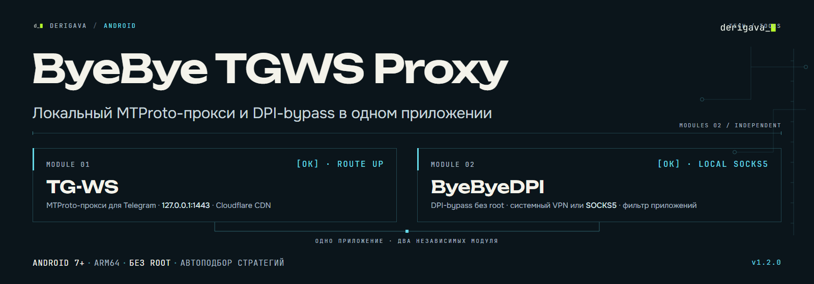
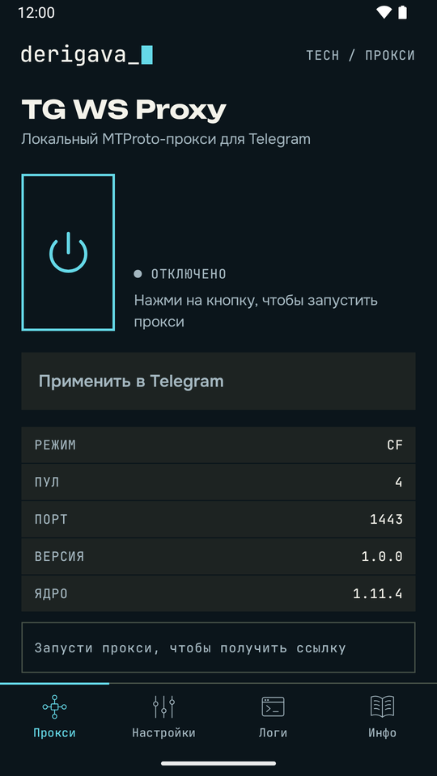
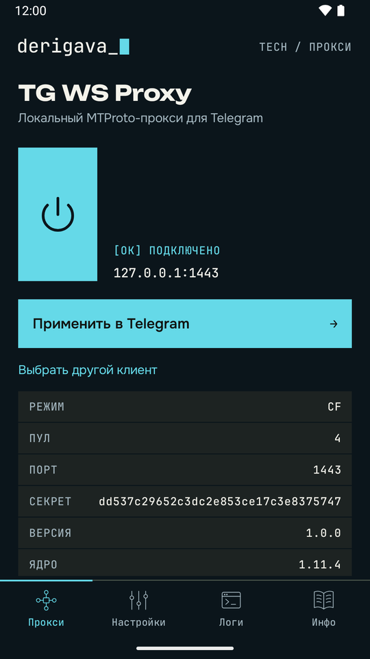
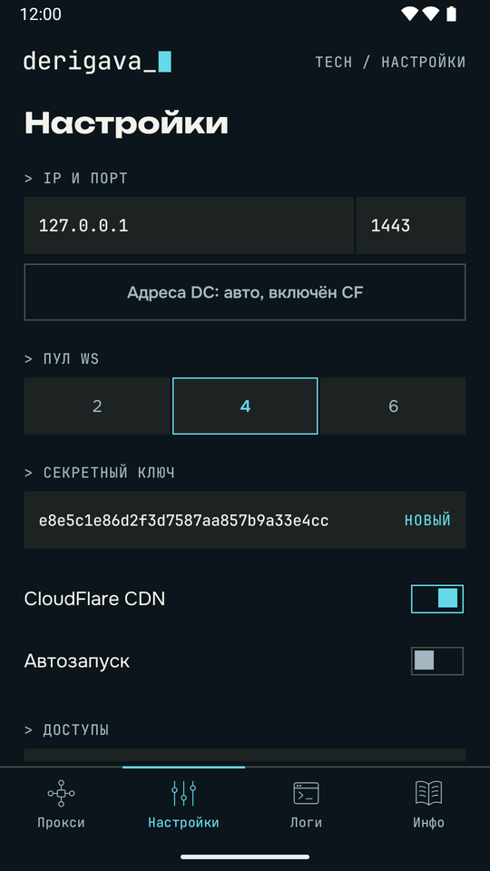
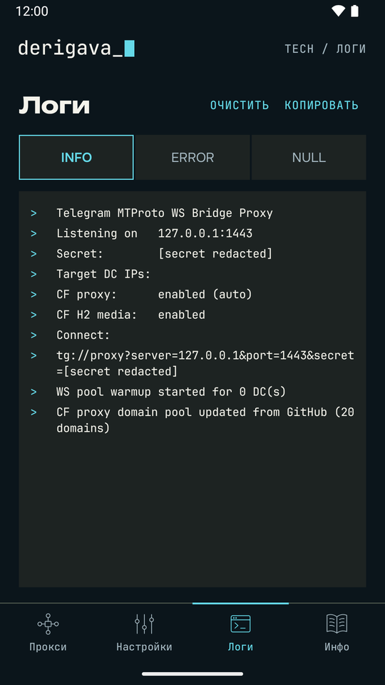

<p align="center">
  <picture>
    <source media="(prefers-color-scheme: dark)" srcset="docs/assets/banner-dark.png">
    <source media="(prefers-color-scheme: light)" srcset="docs/assets/banner-light.png">
    
  </picture>
</p>

<p align="center">
  <a href="https://github.com/Derigava/tg-ws-proxy-android/releases/latest"></a>
  <a href="https://github.com/Derigava/tg-ws-proxy-android/actions/workflows/android-release.yml"></a>
  <a href="LICENSE"></a>
  
</p>

<p align="center"><a href="#english">English</a></p>

TG-WS Proxy — одно приложение с двумя независимыми модулями:

- **TG-WS** поднимает локальный MTProto-прокси, а Telegram подключается к нему как к обычному прокси. VPN для этого модуля не нужен.
- **ByeByeDPI** — нативный обход DPI. По умолчанию работает как системный VPN для всего телефона, второй режим — локальный SOCKS5. Оба режима без root.

```text
Telegram → 127.0.0.1:1443 (MTProto) → ядро Flowseal → DC Telegram
Трафик приложений → VPN ByeByeDPI (или SOCKS5 127.0.0.1:1080) → интернет
```

Ядро TG-WS — исходное Python-ядро [Flowseal/tg-ws-proxy](https://github.com/Flowseal/tg-ws-proxy) без изменений; нативная часть ByeByeDPI — [romanvht/ByeByeDPI](https://github.com/romanvht/ByeByeDPI) `v.1.8.2` с её зависимостями. Android-обвязка выросла из [amurcanov/tg-ws-proxy-android](https://github.com/amurcanov/tg-ws-proxy-android).

| Запуск | Работает | Настройки | Логи |
|:---:|:---:|:---:|:---:|
|  |  |  |  |

## Установка

1. Скачай `tgwsproxy-*-arm64.apk` из [последнего релиза](https://github.com/Derigava/tg-ws-proxy-android/releases/latest) и установи. Нужны Android 7.0+ и ARM64.
2. Открой приложение и разреши уведомления, чтобы видеть состояние прокси и останавливать его из шторки. Параметры работы в фоне описаны в разделе [«Доступы»](#доступы).
3. Нажми кнопку TG-WS со значком питания и дождись `[OK] ПОДКЛЮЧЕНО`.
4. Нажми «Применить в Telegram» и подтверди подключение в клиенте. Если клиентов несколько, приложение спросит, какой открыть.

Правая кнопка запускает ByeByeDPI: при первом включении Android спросит согласие на VPN, потом появится уведомление. Если уже работает другой VPN, приложение предложит заменить его (с явным подтверждением), перейти на SOCKS5 или отменить. SOCKS5 работает без VPN и занимает `127.0.0.1:1080`.

Для ручной настройки на главном экране есть адрес, порт, секрет и ссылка `tg://proxy`. После смены настроек перезапусти прокси.

## Свой Cloudflare

В «Настройки → Свой Cloudflare» два поля, оба принимают несколько доменов через запятую:

- **Домены CF-прокси** заменяют общий список доменов. Работают при включённом CloudFlare CDN.
- **CF Worker** — домены твоих [воркеров](https://github.com/Flowseal/tg-ws-proxy). Ядро пробует их первым, до CF-прокси и прямого подключения, даже при выключенном CloudFlare CDN. Свой воркер не делит квоту с другими пользователями.

В отчёт для issue попадает только число воркеров, сами домены нет.

## Управление без интерфейса

Долгое нажатие на иконку даёт ярлыки «Запустить прокси» и «Остановить прокси». Их можно вынести на рабочий стол или повесить на жест. Есть ещё плитка в шторке. Приложения автоматизации (MacroDroid, Tasker) запускают активность `com.amurcanov.tgwsproxy.ProxyShortcutActivity` пакета `io.github.derigava.tgwsproxy` с действием:

| Действие | Что делает |
|---|---|
| `io.github.derigava.tgwsproxy.action.START` | Запускает прокси с сохранёнными настройками |
| `io.github.derigava.tgwsproxy.action.STOP` | Останавливает прокси |
| `io.github.derigava.tgwsproxy.action.TOGGLE` | Переключает |

Запросы от приложений автоматизации требуют подтверждения на экране. Ярлыки рабочего стола и плитка применяют действие по нажатию.

## Доступы

| Что | Зачем | Что будет без этого |
|---|---|---|
| Уведомления | Показывают, что прокси запущен, и дают кнопки перезапуска и остановки | Прокси работает, но управлять им из шторки нельзя |
| Экономия заряда | При остановках прокси с выключенным экраном открывает системный список оптимизации батареи | На некоторых устройствах Android может приостанавливать прокси в фоне |
| Автозапуск в прошивке | Xiaomi, Huawei, Honor, Oppo, realme, OnePlus, Vivo и Asus держат свой список. Строка появляется только на этих устройствах | Прошивка может завершить приложение. Статус прочитать нельзя, проверь вручную |

Текущее состояние видно в разделе «Настройки → Доступы». На Samsung отключения экономии заряда обычно хватает, но проверь, что приложения нет в списке спящих.

## Обновления

Приложение раз в 12 часов проверяет сведения о последнем релизе через WorkManager. Кнопка «Открыть релиз на GitHub» открывает страницу этого тега. Скачай APK со страницы релиза и установи его через Android. Android проверяет подпись при обновлении установленного пакета.

Сертификат подписи, SHA-256:

```text
6b7e992f93bd0bfd8c9395ddf92d0e3684d236b0f29cdf637dfca80e20b60195
```

Проверить скачанный файл и сравнить его хеш с `SHA256SUMS` в том же релизе:

```bash
sha256sum -c SHA256SUMS
apksigner verify --verbose --print-certs tgwsproxy-*-arm64.apk
```

## Play Protect и установка вне Google Play

Приложение ставится APK, поэтому Play Защита проверяет его как приложение из интернета. Начиная с 1.1.1 сборка не запрашивает `REQUEST_INSTALL_PACKAGES` и `REQUEST_IGNORE_BATTERY_OPTIMIZATIONS`, не скачивает и не устанавливает APK: кнопка обновления открывает страницу релиза в браузере, установку подтверждает Android.

В 1.1.0 был встроенный self-update, и Play Защита блокировала установку как «вредоносное приложение». Это ложная классификация: приложение не собирает данные и не имеет чувствительных разрешений. В текущей версии возможности установки APK удалены, а CI проверяет, что они не вернутся.

Официальная сборка называется `TG WS Proxy`, сертификат подписи SHA-256:

```text
6b7e992f93bd0bfd8c9395ddf92d0e3684d236b0f29cdf637dfca80e20b60195
```

Проверить скачанный файл:

```bash
sha256sum -c SHA256SUMS
apksigner verify --verbose --print-certs tgwsproxy-*-arm64.apk
```

Если Play Защита блокирует установку официальной сборки:

- нажми «Подробнее» → «Всё равно установить», если кнопка доступна;
- если кнопки нет, пришли версию Android, имя APK, SHA-256 и откуда скачан файл: это ложное срабатывание, его снимает [апелляция в Google](https://support.google.com/googleplay/android-developer/contact/protectappeals). Шаблон и подробности — в [docs/PLAY_PROTECT.md](docs/PLAY_PROTECT.md);
- не отключай Play Защиту целиком и не устанавливай APK из сторонних источников.

Предупреждение «неизвестное приложение» для sideload-сборки — нормальное; оно не означает, что в APK есть вредоносный код.

## Как выходят релизы

В `upstream/flowseal.lock.json` записаны тег, коммит и SHA-256 всех файлов ядра. Единственная правка в снимке Flowseal выбирает встроенную библиотеку OpenSSL Chaquopy для AES на Android. GitHub Actions раз в сутки показывает доступный тег Flowseal. Чтобы обновить ядро, выполни `python scripts/sync_upstream.py --ref vX.Y.Z`, проверь изменения и внеси их в `main`.

Для выпуска запусти workflow **Android checks and releases** на `main` с включённым `publish_release`. Он выполняет следующие шаги.

1. Python-тесты ядра и адаптера.
2. Сборка ARM64 APK и проверка нативных библиотек на страницы памяти 16 КБ.
3. Запуск оптимизированного релиза на эмуляторах API 24 и API 35 с 16 КБ, затем инструментальные тесты.
4. Сверка хеша проверенного APK, подпись прежним сертификатом и публикация. К публичному APK GitHub Actions добавляет аттестацию происхождения.

Если что-то падает, релиз не выходит и рабочая версия остаётся на месте.

Для проверки Play Защитой владелец репозитория может запустить этот workflow с `play_protect_recipient`. В поле передаётся сертификат получателя в PEM, закодированный в Base64. После тестов Actions подписывает ARM64 APK релизным ключом и сохраняет зашифрованный CMS-артефакт на сутки. Его можно расшифровать локально командой `openssl cms -decrypt -binary -inform DER -in play-protect-preview.der -recip recipient.pem -inkey recipient.key -out preview.apk`.

Номер версии: в `VERSION` лежит линейка `MAJOR.MINOR`, а CI берёт следующий свободный патч, например `1.1.0`, затем `1.1.1`. Для новой линейки достаточно поменять `VERSION`. Что изменилось, описано в [CHANGELOG.md](CHANGELOG.md). Раздел с номером версии попадает в начало текста релиза.

## Сборка

Нужны JDK 21, Python 3.13, Android SDK platform 35 и build-tools 36.0.0. SDK задаётся через `ANDROID_HOME` или `local.properties`.

```bash
python -m pip install -r scripts/requirements-test.txt
python scripts/run_python_tests.py
./gradlew :app:assembleArm64Release
```

На Windows вместо `./gradlew` используй `gradlew.bat`, а Python-тесты запускай через `py -3.13 -m unittest discover -s tests/python` и `tests/scripts`: часть сетевых тестов Flowseal с короткими таймаутами в Windows не укладывается во время, поэтому полный набор идёт на Linux.

Без ключа получится неподписанный APK. Для подписи задай `TGWS_KEYSTORE_FILE`, `TGWS_KEYSTORE_PASSWORD`, `TGWS_KEY_ALIAS` и `TGWS_KEY_PASSWORD`. Проверить, что ядро не изменено:

```bash
python scripts/sync_upstream.py --check
```

## Что важно знать

- Приложение неофициальное и не связано с Telegram.
- Модуль TG-WS — это прокси для Telegram, а не системный VPN: другой трафик через него не идёт. Модуль ByeByeDPI по умолчанию обслуживает весь телефон через системный VPN или работает как локальный SOCKS5.
- ByeByeDPI не обещает шифрование и не меняет твой IP: он усложняет обнаружение трафика DPI-системой. Подбор стратегии не гарантирует доступ к любому сайту у любого провайдера.
- Прокси слушает `127.0.0.1`, поэтому доступен только на этом телефоне. Адрес `0.0.0.0` в настройках открывает его всей локальной сети.
- При первом применении выбери клиент, которому передать адрес, порт и секрет. Приложение запоминает выбор вместе с подписью клиента.
- Прокси подключается к Telegram и в зависимости от настроек использует твой Worker или общий Cloudflare-прокси. Оператор промежуточного узла может видеть IP и параметры соединения. Flowseal обновляет список общих доменов с GitHub.
- Работа зависит от маршрута, DNS и провайдера. Если подключение висит, перезапусти прокси и сравни с включённым и выключенным Cloudflare.
- При сбое переключения сети или пропаже интернета прокси сам сбрасывает накопленные задержки маршрутов, перезапуск не нужен.
- Нашёл ошибку — приложи отчёт из «Инфо → Собрать отчёт», секрета в нём нет. В нём ошибки и события за 24 часа из журнала, который ведётся и в фоне. Для долгих отвалов приложи файл из «Инфо → Поделиться журналом»: секрет и домены воркеров в нём замаскированы. Об уязвимостях пиши по правилам из [SECURITY.md](SECURITY.md).

## Лицензии и авторы

- Android-приложение: [GPLv3](LICENSE). Проект основан на работе [amurcanov](https://github.com/amurcanov/tg-ws-proxy-android), история коммитов сохранена. Поскольку оригинальный репозиторий сейчас архивирован, я продолжаю развивать Android-реализацию, исправлять проблемы, описанные в Issues, и поддерживать совместимость с актуальным ядром Flowseal.
- Ядро TG-WS: [MIT](upstream/flowseal/LICENSE), [Flowseal](https://github.com/Flowseal/tg-ws-proxy).
- Нативная часть ByeByeDPI: [GPL-3.0](upstream/byebyedpi/LICENSE), [romanvht/ByeByeDPI](https://github.com/romanvht/ByeByeDPI) `v.1.8.2`; встроенные зависимости [hufrea/byedpi](https://github.com/hufrea/byedpi) (MIT), [heiher/hev-socks5-tunnel](https://github.com/heiher/hev-socks5-tunnel) (MIT), hev-socks5-core/hev-task-system/yaml (MIT), [lwip](https://savannah.nongnu.org/projects/lwip/) (BSD-3-Clause) и предустановленный wintun (WireGuard). Состав и лицензии закреплены в `upstream/byebyedpi.lock.json`.
- Шрифты Unbounded, Onest и JetBrains Mono: [SIL OFL 1.1](licenses/fonts).
- Знак `derigava_█` не передаётся вместе с кодом, подробности в [NOTICE.md](NOTICE.md).

---

## English

TG-WS Proxy is one app with two independent modules:

- **TG-WS** runs a local MTProto proxy on your phone and Telegram connects to it as a normal proxy. This module needs no VPN. It uses the Python core of [Flowseal/tg-ws-proxy](https://github.com/Flowseal/tg-ws-proxy) with an Android AES library selection.
- **ByeByeDPI** is the native DPI bypass from [romanvht/ByeByeDPI](https://github.com/romanvht/ByeByeDPI) `v.1.8.2`. It defaults to a device-wide system VPN; the second mode is a local SOCKS5 at `127.0.0.1:1080`. Neither mode needs root.

The Android wrapper grew out of [amurcanov/tg-ws-proxy-android](https://github.com/amurcanov/tg-ws-proxy-android).

1. Download `tgwsproxy-*-arm64.apk` from the [latest release](https://github.com/Derigava/tg-ws-proxy-android/releases/latest). It needs Android 7.0+ and ARM64.
2. Open the app and allow notifications to see the status and stop it from the notification.
3. Tap the TG-WS power button and wait for `[OK] CONNECTED`.
4. Tap "Apply in Telegram", choose the client that will receive the proxy secret, and confirm in the client.

The right button starts ByeByeDPI. On first run Android asks for VPN consent; then a notification appears. If another VPN is active, the app offers to replace it (with explicit confirmation), switch to SOCKS5, or cancel. ByeByeDPI does not promise encryption or hide your IP — it makes traffic harder for DPI systems to detect, and no strategy guarantees access to every site on every provider.

Settings → Own Cloudflare takes your own CF proxy domains and Cloudflare Worker domains (comma-separated). Workers are tried first, even with CloudFlare CDN off. Long-press the app icon for Start/Stop shortcuts. Automation intents for `com.amurcanov.tgwsproxy.ProxyShortcutActivity` require confirmation.

The app checks GitHub release metadata every 12 hours. Open the release page to download the APK and confirm installation in Android. The app is unofficial and independent of Telegram. Switch the language in Settings.

Sideloaded builds may trigger Play Protect. Since 1.1.1 the app requests no install or battery-exemption permissions, never downloads or installs APKs, and only opens the GitHub release page. Verify the official APK with `SHA256SUMS` and the signing certificate above; see [docs/PLAY_PROTECT.md](docs/PLAY_PROTECT.md) if Play Protect blocks installation.
