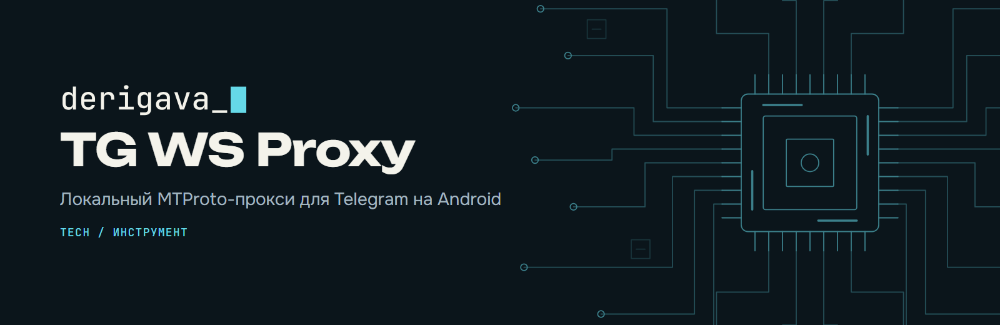
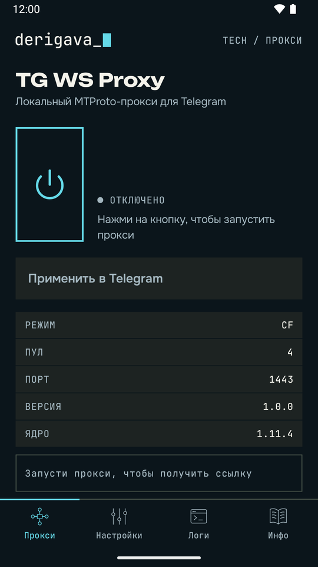
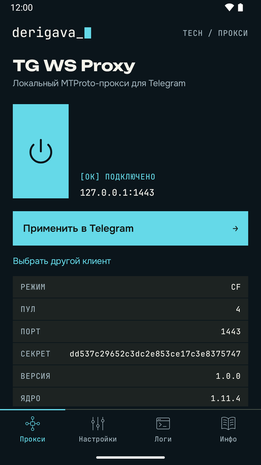
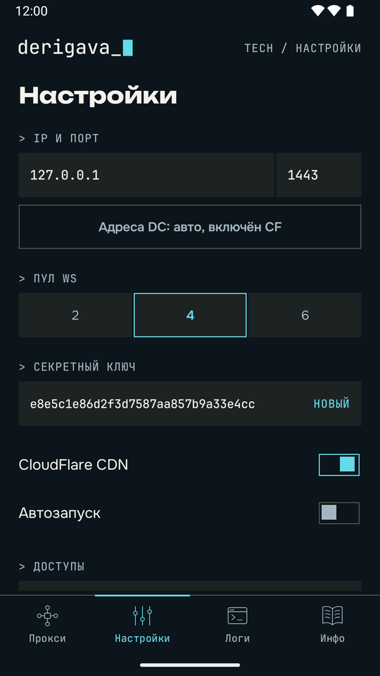
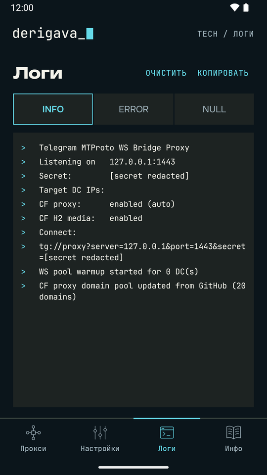

<p align="center">
  <picture>
    <source media="(prefers-color-scheme: dark)" srcset="docs/assets/banner-dark.png">
    <source media="(prefers-color-scheme: light)" srcset="docs/assets/banner-light.png">
    
  </picture>
</p>

<p align="center">
  <a href="https://github.com/Derigava/tg-ws-proxy-android/releases/latest"></a>
  <a href="https://github.com/Derigava/tg-ws-proxy-android/actions/workflows/android-release.yml"></a>
  <a href="LICENSE"></a>
  
</p>

<p align="center"><a href="#english">English</a></p>

TG WS Proxy поднимает на телефоне локальный MTProto-прокси, а Telegram подключается к нему как к обычному прокси. Root и VPN не нужны. Движок — исходное Python-ядро [Flowseal/tg-ws-proxy](https://github.com/Flowseal/tg-ws-proxy) без изменений, Android-обвязка выросла из [amurcanov/tg-ws-proxy-android](https://github.com/amurcanov/tg-ws-proxy-android).

```text
Telegram → 127.0.0.1:1443 (MTProto) → ядро Flowseal → DC Telegram
```

| Запуск | Работает | Настройки | Логи |
|:---:|:---:|:---:|:---:|
|  |  |  |  |

## Установка

1. Скачай `tgwsproxy-*-arm64.apk` из [последнего релиза](https://github.com/Derigava/tg-ws-proxy-android/releases/latest) и установи. Нужны Android 7.0+ и ARM64.
2. Открой приложение и разреши то, что оно попросит: уведомления и работу без экономии заряда. Зачем это нужно, написано в разделе [«Доступы»](#доступы).
3. Нажми кнопку со значком питания и дождись `[OK] ПОДКЛЮЧЕНО`.
4. Нажми «Применить в Telegram» и подтверди подключение в клиенте. Если клиентов несколько, приложение спросит, какой открыть.

Для ручной настройки на главном экране есть адрес, порт, секрет и ссылка `tg://proxy`. После смены настроек перезапусти прокси.

## Доступы

| Что | Зачем | Что будет без этого |
|---|---|---|
| Уведомления | Показывают, что прокси запущен, и дают кнопки перезапуска и остановки | Прокси работает, но управлять им из шторки нельзя |
| Без экономии заряда | Android не усыпляет прокси при выключенном экране | Telegram теряет соединение в фоне |
| Автозапуск в прошивке | Xiaomi, Huawei, Honor, Oppo, realme, OnePlus, Vivo и Asus держат свой список. Строка появляется только на этих устройствах | Прошивка может завершить приложение. Статус прочитать нельзя, проверь вручную |
| Установка обновлений | Ставит новые версии из приложения | Обновление придётся скачивать и ставить вручную |

Текущее состояние видно в разделе «Настройки → Доступы». На Samsung отключения экономии заряда обычно хватает, но проверь, что приложения нет в списке спящих.

## Обновления

Приложение раз в 12 часов проверяет последний релиз через WorkManager. APK скачивается только после нажатия «Обновить». Перед установкой приложение сверяет размер, SHA-256 из `SHA256SUMS`, имя пакета, версию и сертификат подписи, а саму установку подтверждаешь в Android.

Сертификат подписи, SHA-256:

```text
6b7e992f93bd0bfd8c9395ddf92d0e3684d236b0f29cdf637dfca80e20b60195
```

Проверить скачанный файл:

```bash
apksigner verify --print-certs tgwsproxy-*-arm64.apk
```

## Как выходят релизы

Ядро лежит в `upstream/flowseal` без правок, а `upstream/flowseal.lock.json` фиксирует тег, commit и SHA-256 всех файлов. GitHub Actions каждые шесть часов проверяет стабильные релизы Flowseal. Новое ядро проходит такой путь:

1. Python-тесты ядра и адаптера.
2. Сборка ARM64 APK и проверка нативных библиотек на страницы памяти 16 КБ.
3. Запуск оптимизированного релиза на эмуляторах API 24 и API 35 с 16 КБ, затем инструментальные тесты.
4. Подпись в отдельной задаче, куда попадает только проверенный APK, и публикация релиза.

Если что-то падает, релиз не выходит и рабочая версия остаётся на месте.

## Сборка

Нужны JDK 21, Python 3.13, Android SDK platform 35 и build-tools 36.0.0. SDK задаётся через `ANDROID_HOME` или `local.properties`.

```bash
python -m pip install -r scripts/requirements-test.txt
python scripts/run_python_tests.py
./gradlew :app:assembleArm64Release
```

На Windows вместо `./gradlew` используй `gradlew.bat`, а Python-тесты запускай через `py -3.13 -m unittest discover -s tests/python` и `tests/scripts`: часть сетевых тестов Flowseal с короткими таймаутами в Windows не укладывается во время, поэтому полный набор идёт на Linux.

Без ключа получится неподписанный APK. Для подписи задай `TGWS_KEYSTORE_FILE`, `TGWS_KEYSTORE_PASSWORD`, `TGWS_KEY_ALIAS` и `TGWS_KEY_PASSWORD`. Проверить, что ядро не изменено:

```bash
python scripts/sync_upstream.py --check
```

## Что важно знать

- Приложение неофициальное и не связано с Telegram.
- Это прокси для Telegram, а не системный VPN: другой трафик через него не идёт.
- Прокси слушает `127.0.0.1`, поэтому доступен только на этом телефоне. Адрес `0.0.0.0` в настройках открывает его всей локальной сети.
- Работа зависит от маршрута, DNS и провайдера. Если подключение висит, перезапусти прокси и сравни с включённым и выключенным Cloudflare.
- Нашёл ошибку — приложи отчёт из «Инфо → Собрать отчёт», секрета в нём нет. Об уязвимостях пиши по правилам из [SECURITY.md](SECURITY.md).

## Лицензии и авторы

- Android-приложение: [GPLv3](LICENSE). Проект основан на работе amurcanov. Поскольку оригинальный репозиторий сейчас архивирован, я продолжаю развивать Android-реализацию, исправлять проблемы, описанные в Issues, и поддерживать совместимость с актуальным ядром Flowseal, история коммитов сохранена.
- Ядро: [MIT](upstream/flowseal/LICENSE), [Flowseal](https://github.com/Flowseal/tg-ws-proxy).
- Шрифты Unbounded, Onest и JetBrains Mono: [SIL OFL 1.1](licenses/fonts).
- Знак `derigava_█` не передаётся вместе с кодом, подробности в [NOTICE.md](NOTICE.md).

---

## English

TG WS Proxy runs a local MTProto proxy on your phone, and Telegram connects to it like any other proxy. No root or VPN needed. The engine is the unmodified Python core of [Flowseal/tg-ws-proxy](https://github.com/Flowseal/tg-ws-proxy); the Android wrapper grew out of [amurcanov/tg-ws-proxy-android](https://github.com/amurcanov/tg-ws-proxy-android).

1. Download `tgwsproxy-*-arm64.apk` from the [latest release](https://github.com/Derigava/tg-ws-proxy-android/releases/latest). It needs Android 7.0+ and ARM64.
2. Open the app and allow notifications and running without battery optimization, so Android doesn't stop the proxy with the screen off.
3. Tap the power button and wait for `[OK] CONNECTED`.
4. Tap "Apply in Telegram" and confirm in the client.

The in-app updater checks the latest release every 12 hours. It verifies the size, SHA-256, package name, version and signing certificate before Android asks you to confirm the install. The app is unofficial and not affiliated with Telegram. Switch the language in Settings.
